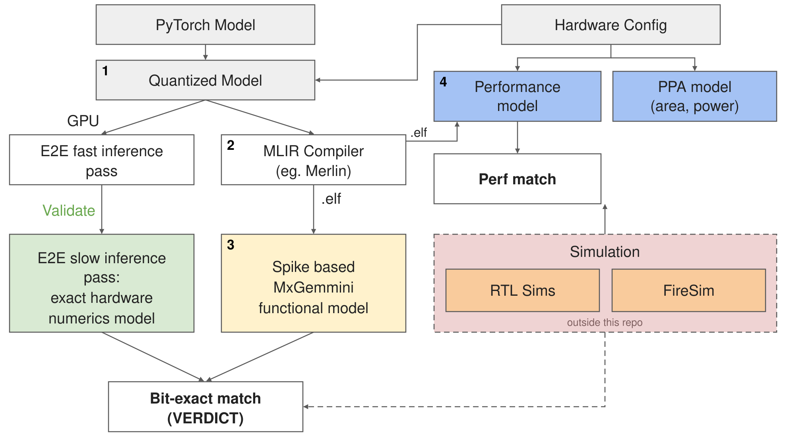

# npu-exploration



Design-space exploration for matrix accelerators. You give it two things, a
**hardware config** for your accelerator and a **PyTorch model** at full precision, and it:

1. **quantizes** the model given a quantization algorithm,
2. **compiles** it with MLIR to custom instructions in a bare-metal ELF,
3. **evaluates** that ELF on spike, bit for bit against the quantized model, and
4. **estimates the cost** of your hardware: area, power, energy and cycles.

This flow is actively on development using MxGemmini.

## Quickstart

```bash
git clone --recurse-submodules git@github.com:ucb-bar/npu-exploration.git
cd npu-exploration
bash scripts/setup.sh          # python env, RISC-V toolchain, spike, gemmini sources (idempotent)
source scripts/env.sh

.venv/bin/python npu.py --hw config/hardware/baseline.json --model examples/mlp.py:MLP
```

```
[steps   ] quantize -> compile -> evaluate -> cost
...
VERDICT  PASS  hardware == mxquant  (4096/4096 identical, max|d| 0)
         MXQuant as shipped is 16.31% from the hardware -- the model-vs-silicon gap
         fp32 12.1962% (context), cycles 1989628
PPA  ...   PERF  ...                      (with MxGemmini-workspace cloned beside the repo)
RESULTS  results/20261104-022510_MLP_64x64x128x128x64
```

Setup details and troubleshooting: [docs/setup.md](docs/setup.md).

## Four steps

Every step runs by default. Skip any with `--skip`, or pick a subset with `--only`.

| step | what it does | output | needs |
|---|---|---|---|
| `quantize` | runs the bit-exact quantized model of your hardware (mxq) | the bits the hardware must produce; error vs fp32 | python only |
| `compile` | lowers the model to RoCC instructions, builds a bare-metal ELF | `out/compile/<model>/<target>/`: ELF, C, expected bits | RISC-V toolchain |
| `evaluate` | runs the ELF on spike, compares bit for bit with `quantize` | `VERDICT PASS/FAIL`, modelled cycles | `compile`, spike |
| `cost` | prices the hardware and the model's run on it | `PPA` (area, power), `PERF` (cycles, energy) | MxGemmini-workspace |

```bash
npu.py --hw baseline --model m.py:Block                        # all four
npu.py --hw baseline --model m.py:Block --skip evaluate        # compile to an ELF, no spike
npu.py --hw wide_acc --model m.py:Block --only quantize,cost   # explore without a toolchain
npu.py --hw baseline --model m.py:Block --skip evaluate --target mx_rocket   # ELF for RTL / FPGA
npu.py --list                                                  # configs and built-in models
```

## Key terms

- **Hardware config** (`--hw`): one JSON file that defines the accelerator (mesh size, product and
  accumulator precisions, scale group, scratchpad, LUT unit, clock). Every step reads the same file.
- **Run config** (`--run`): how software drives that hardware: operand format (`fp8_e4m3`, `fp4_e2m1`,
  ...), rounding, pass threshold. Defaults to `config/run/default.json`.
- **Model** (`--model FILE.py:Name`): a plain `nn.Module`. Traced with torch.fx into matmuls on the
  accelerator and host ops (softmax, RMSNorm, SiLU, RoPE) on the Rocket core.
- **Quantized model** (`mxquant`): an independent implementation of the hardware's arithmetic on the
  [mxq](https://github.com/chloe-wong/microscaling-quant) library. It is the reference the hardware is
  graded against.
- **VERDICT**: whether spike's output is bit-identical to the quantized model. The error against fp32 is
  reported as context: it is the cost of the format, not a correctness check.

## Repository layout

```
npu.py          the entry point
config/         hardware/*.json and run/*.json, the two inputs that describe the machine
kernels/        the model tracer (PyTorch -> stages) and built-in example models
compiler/       lowering and the MxGemmini-on-Rocket backend (C emitters, spike runner)
models/         quantize (mxquant), evaluate (spike, reference), cost (ppa, perf)
grade/          the pipeline that runs the steps, compares, and writes results/
rtl_exact/      hardware-exact datapath models the quantized model is checked against
examples/       a minimal PyTorch model to start from
tests/          self-tests, one claim each
scripts/        setup.sh and env.sh
baremetal/      hand-written TinyLlama kernels for MxGemmini
sim/            simq (RTL simulation queue) and the RTL regression jobs
merlin/, microscaling-quant/    submodules: the MLIR compiler framework and mxq
```

## Documentation

| doc | covers |
|---|---|
| [setup.md](docs/setup.md) | install, environment, troubleshooting |
| [hardware-config.md](docs/hardware-config.md) | input 1: every hardware and run config field |
| [model.md](docs/model.md) | input 2: what a PyTorch model may contain, shape rules, built-in examples |
| [quantize.md](docs/quantize.md) | step 1: the quantized model, formats, the perplexity path |
| [compile.md](docs/compile.md) | step 2: lowering, the backend, the ELF directory |
| [evaluate.md](docs/evaluate.md) | step 3: spike, the verdict, what each run records |
| [cost.md](docs/cost.md) | step 4: area, power, energy and cycle models |
| [testing.md](docs/testing.md) | the self-tests and the claim each one holds |
