# Radiance SoC performance model: cyclotron + libgemmini

How the Radiance cluster is modeled end to end: the Muon GPU cores in **cyclotron**, and the MX‑Gemmini matrix unit in **libgemmini**, joined at the same MMIO interface the RTL uses. It also covers how the model is calibrated against the VCS RTL.

The model is in two repositories:

- cyclotron, branch `gemmini-integration`
- libgemmini (`cyclotron/libgemmini`), branch `cyclotron-integration`

The step-by-step log is `planning/radiance_cyclotron_gemmini_plan.md`.

---

## 1. The big picture

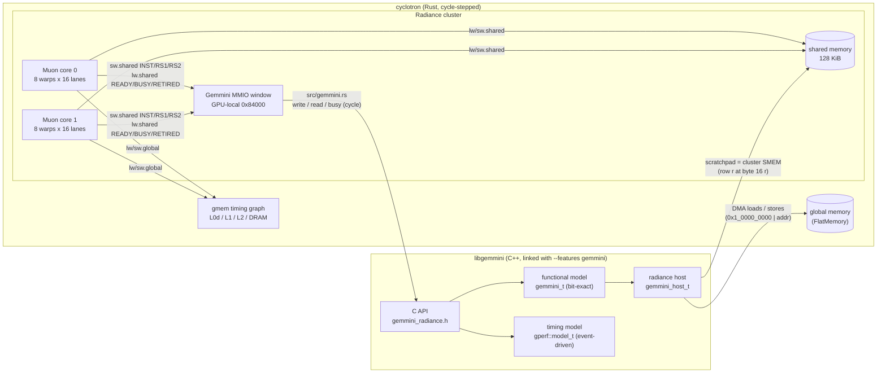

**Design rules**

1. **Gemmini sits behind the RTL's interface, not a made-up one.**
   - Muon reaches Gemmini only with `sw.shared` / `lw.shared` to the register block, as the RTL `GemminiTile.scala:360-390` does.
   - A refused INST store stalls and replays the warp, which is the RTL's `io.cmd.ready` back-pressure.
2. **One Gemmini model, two hosts.** libgemmini's functional and timing models don't know which SoC they are in. A *host* object provides memory, the scratchpad, and the clock (§3). The Rocket/Spike flow still works unchanged.
3. **"both" mode.** The functional model computes bit-exact results while the timing model decides when things happen. On fa_mxfp8_sr, all 32,768 outputs are exact in cyclotron, and on gemm_mx all 262,144.
4. **Changes to cyclotron are kept isolated and opt-in.**
   - New behavior lives in new files: `src/gemmini.rs`, `src/muon/hazards.rs`, and `config/timing/radiance/*.toml`.
   - It is switched on by config sections; with them off, a run is cycle-identical to upstream.

---

## 2. The MMIO interface

| Offset (from 0x84000) | Register | Access | Model call |
|---|---|---|---|
| +0x00 | INST (funct) | write: issues the command | `model_t::offer(t, funct, rs1, rs2)`: false while the command path is full |
| +0x08 | READY | read | `cmd_ready(t)`: the front end is not full |
| +0x10 | RS1 | write | latched |
| +0x18 | RS2 | write | latched |
| +0x20 | BUSY | read | `busy(t)`: commands in flight, or busy until ≥ t |
| +0x28 | OCCUPANCY | read | `loops_pending(t)`: LOOP_WS accepted − unrolled |
| +0x38 | RETIRED | read | `loops_retired(t)`: LOOP_WS whose every command finished, in issue order |

Scale memory, LUTs and the requantizer are **not** written through MMIO. As in the latest RTL, the commands `MX_LOAD_SCALES` (including the gated `rs2[54]` form), `MX_LOAD_LUT` and `SPAD_REQUANT` trigger a DMA, and the timing model has a unit for each: the scale loader, LUT loader and requant path.

### One command, cycle by cycle

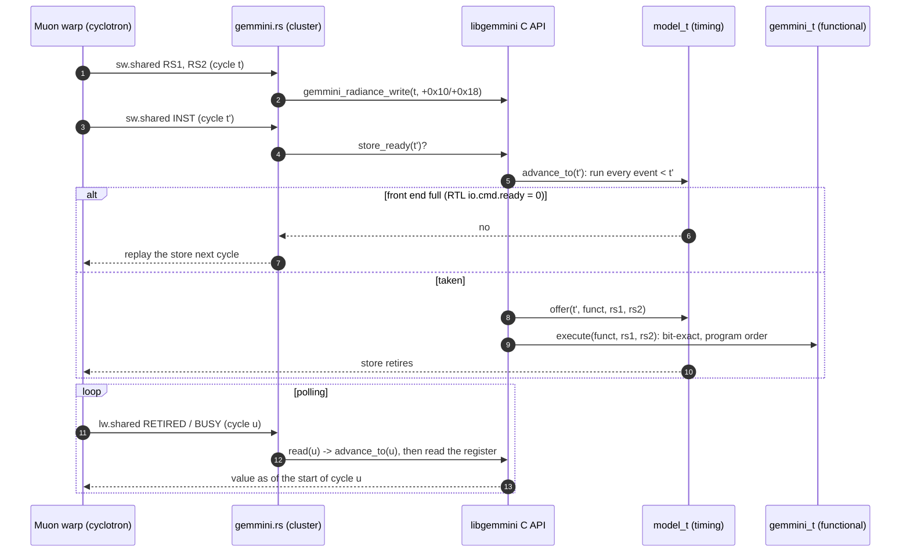

**Synchronizing the two clocks.**

- cyclotron steps one cycle at a time; libgemmini is event-driven.
- Every register access carries cyclotron's current cycle `t`. libgemmini first runs all of its events strictly before `t` (`advance_to`), then serves the access, so a read sees the registers as cycle `t` begins.
- Nothing in libgemmini runs ahead of the GPU, so the two never disagree about causality.

---

## 3. The host layer (one Gemmini, two SoCs)

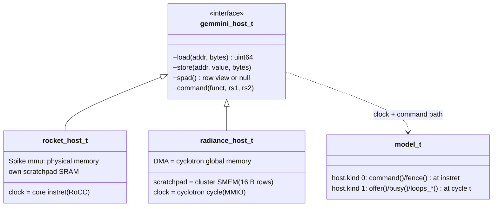

| | Rocket (`preset mx_rocket`, …) | Radiance (`preset radiance`) |
|---|---|---|
| Command path | retired RoCC custom instruction | MMIO store to INST |
| Clock | Spike instret + host core model | cyclotron cycle |
| Scratchpad | Gemmini's own SRAM | cluster shared memory, 2048 rows × 4 banks (128 KiB) |
| Accumulator | ACC_ROWS | 256 rows (2 halves of 128) |
| DMA / bus | Rocket L2 / memory, CPU L1 probing (`mem.host_tracking`) | 32 B lines and bus; no CPU-L1 coherence |
| Front end | RoCC queue latency 5 | raw_cmd_q, LoopConv, LoopMatmul: depth 6, latency 3 [estimate] |

Each preset is a `config_t` (`perf/params/config.cc`). Single values can be overridden with `GEMMINI_PERF_SET="section.name=value,..."`, or with `[gemmini] overrides = "…"` in cyclotron's config.

---

## 4. Inside the Gemmini timing model (libgemmini `perf/`)

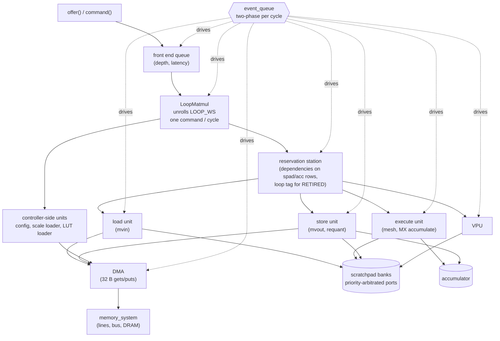

**Event queue: two phases per cycle**

- Every unit is a process that schedules its own next step. `at()` events run first (evaluate: read state, decide); `commit()` events run after them (the register updates).
- A commit is invisible to every decision in its own cycle, whatever order the events were inserted in, just as in clocked logic. This removed the same-cycle races; for example, the store unit's pending banks against a vector issue in the same cycle.
- No unit computes a future time for a resource it doesn't own, so shared resources are always arbitrated in time order.

**LOOP_WS accounting for the MMIO registers**

- Each RS entry carries the serial number of its loop.
- A loop *retires* when all of its entries have completed, in issue order. That is the value RETIRED returns.
- An empty LOOP_WS (every tile skipped) still retires in order.

**Functional details the timing must respect** (all modeled, which is why results are bit-exact):

- **MX accumulator.** 16-row groups of 4 tiles. Compute and store cursors toggle on `inc_acc`, and the skips `rs2[6]` / `rs2[7]` are honored.
- **Gated scale loads.** Each scale half moves through FREE → LOADED → INUSE. A gated `MX_LOAD_SCALES` takes effect only when its half is free, not when it is issued.

---

## 5. Inside the Muon timing model (cyclotron)

Each core is a set of timing servers and queues stepped every cycle. A warp's instruction goes through the stages below. Any stage can refuse it; the warp then *replays* the instruction at the cycle the stage names (`set_resource_wait_until` + `replay_instruction`). The instruction's functional effect happens when its timing is accepted.

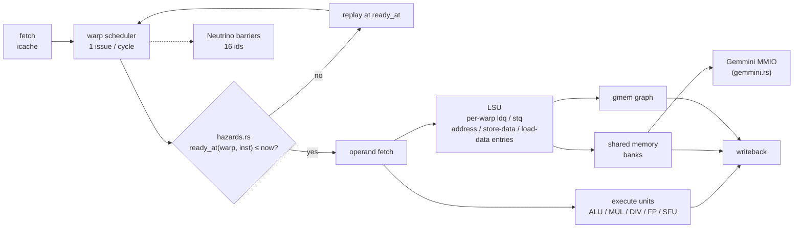

### 5.1 Pipeline hazards (`src/muon/hazards.rs`, `[hazards]`)

cyclotron's original execute path blocked a warp until each instruction completed, which gave roughly 3 cycles per instruction whether dependent or not. The radiance config turns that off (`radiance/execute.toml`: execute units never block) and replaces it with a per-warp model measured on the RTL trace:

- a register scoreboard (`reg_ready[warp][reg]`);
- a per-warp `next_issue` for control-flow redirects, the non-pipelined divider, and `fence.s`.

| Class | RTL: next dependent instruction (cycles) | Config value (= RTL − 1, the replay cycle) |
|---|---|---|
| ALU | 4 (independent 2) | 3 |
| MUL | 37 | 36 |
| FP32 | 7 | 6 |
| BF16 | 6 | 5 |
| SFU (`fexp.h`) | 13 | 12 |
| `lw.shared` → use | 13 | 12 |
| `lw.global` → use (L0 hit) | 16 | 15 |
| DIV (blocks the warp) | 38 | 37 |
| branch / jump / SIMT / CSR → next | 9 | 8 |
| `fence.s` → next | 10 | 9 |

`fence.s` (MISC_MEM f3 = 2) only orders the warp's shared-memory accesses. In the RTL it is a dummy entry in the store queue (`LSU.scala:570`). cyclotron used to send an L1 flush for it, costing 200+ cycles against the RTL's 10.

### 5.2 Global memory graph (`src/timeflow/gmem`, `config/timing/radiance/gmem.toml`)

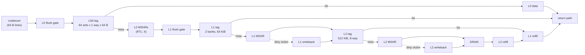

- Hits and misses are decided from addresses (sets and ways per level).
- `write_allocate = true` in the radiance config, because the RTL's L0d (non-blocking DCache), L1 and L2 all allocate on writes.
- Dirty writebacks are currently sent by a fixed rate (`l1/l2_writeback_rate`), not by tracking which lines are dirty (see §7).

Every completed global request is recorded in the trace DB's `gmem_req` table: warp, request cycle, response cycle, store flag, address, bytes, and the L0/L1/L2 hit flags. That table is what the calibration below is measured from.

---

## 6. Calibration against the RTL

**Reference.** The VCS run of `fa_mxfp8_sr` on `RadianceE4M3MxGemminiSingleClusterTraceConfig` (non-HBM) gives kernel_cycles **349,281**. The model runs the exact same ELF, rebuilt from the VCS `.soc.dump` by `tools/radiance_elf_from_dump.py`.

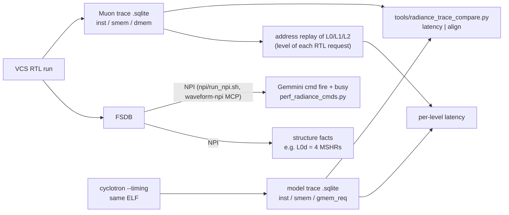

- **`latency`.** For each instruction class, the cycles until the same warp's next instruction, split by whether that instruction reads the result (dependent) or not. Sources are the architectural registers decoded from the ELF; the RTL trace's register ids are physical, after renaming.
- **`align`.** For each warp, the k-th barrier and the k-th Gemmini register store, measured from the kernel's START stamp, and how far the model drifts from the RTL.
- **RTL level inference.** The RTL trace doesn't record which cache served a request, so I replay its addresses through an L0/L1/L2 model. Applied to the model's own trace, this replay gives counts close to the model's actual hit flags.

### Results so far

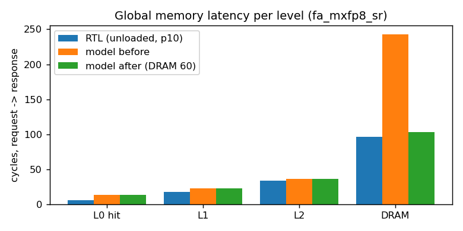

L1 and L2 already match. DRAM was 2.5× too slow: model 243 against RTL p10 96 / p25 112. The L0 hit floor in cyclotron's graph is 10 cycles (the RTL's is 6); this doesn't change kernel time, because the 15-cycle load→use hazard dominates.

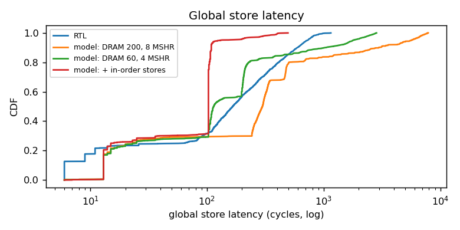

Stores piled up in the model: its p90 was 1,500+ cycles against the RTL's 594. In the RTL, a warp's global stores leave the queue in order, and the queue head advances only on the memory response (`LSU.scala:550-643`). That allows one store in flight per warp, and loads wait for older stores. cyclotron counted a store as done once it left the LSU. With in-order stores the model's tail collapses to p90 110.

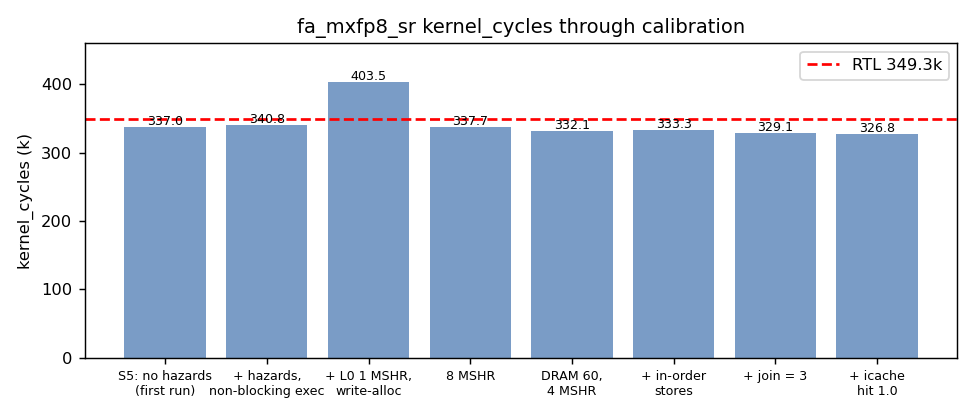

The total has passed close to the RTL more than once **for the wrong reasons**, because errors cancelled. The 337.7k bar looks like a −3% match, but per-interval alignment shows two opposite errors:

- the prologue is ~20k cycles fast;
- the main loop is ~18k cycles slow.

So calibration follows the per-landmark drift, not the total:

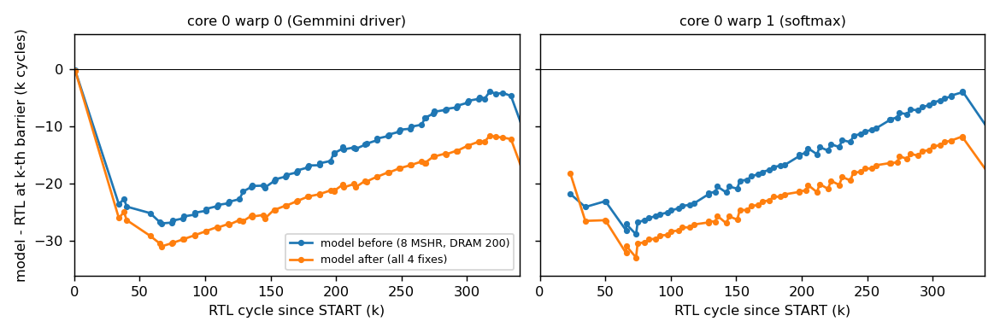

**Reading the drift plot**

- **Prologue (the first 25k cycles):** the drop on both warps, in both versions.
- **Main loop:** from 25k to 330k, both lines climb, meaning the model loses time to the RTL. With all four fixes:
  - warp 0's short command intervals: +46 per interval (was +342);
  - warp 1's softmax intervals: within ±150;
  - what's left is the time Muon waits on Gemmini, about +600–800 per block. That is Gemmini-side calibration (S6c).

---

## 7. Status and open items

| Item | State |
|---|---|
| Functional bit-exactness (gemm_mx, fa_mxfp8_sr) | done |
| Muon hazards, non-blocking execute, `fence.s` | done (committed) |
| gmem completion recording (`gmem_req`) | done |
| L0 MSHRs 8 → 4 (FSDB), DRAM 200 → 60 | done (config only) |
| In-order global store retirement (`store_in_order`) | done |
| `vx_join` hold 3 (the RTL never issues joins) | done |
| icache `hit_rate` 0.98 → 1.0 (RTL loop has no misses) | done (`radiance/icache.toml`) |
| Prologue −18k: 16 warp stacks 128 KiB apart all land in one set at L0/L1/L2; each RTL stack store evicts a dirty line (~630 cycles) | open: needs writebacks driven by which lines are dirty |
| Main loop: Muon waiting on Gemmini, +600–800 per block | open: S6c (per-loop durations, spad-in-SMEM latency, front-end latency, Gemmini DMA path) |
| Validation on more kernels (attn_flash_llama_vb is validation-only) | pending new VCS runs |

**Caveat on the mtests runs.** `mt_new2`, `mt_fa` and `silufuse` ran on the HBM simv. Their code is assembled at launch, so trace PCs can't be mapped to the ELF, and the runs were partial. They are used for memory latency only. They confirm the 6/9-cycle L0 hit and the same queueing on cold stack stores.

### Where things live

| What | Path |
|---|---|
| Cluster ↔ Gemmini bridge | `cyclotron/src/gemmini.rs`, `build.rs` (feature `gemmini`) |
| Muon hazards | `cyclotron/src/muon/hazards.rs` |
| Radiance timing configs | `cyclotron/config/timing/radiance/{gmem,execute,hazards,icache}.toml` |
| SoC config | `cyclotron/config/radiance_e4m3_gemmini.toml` |
| C API | `libgemmini/gemmini_radiance.{h,cc}` |
| Host layer | `libgemmini/gemmini_host.h`, `rocket_host.h` |
| Timing model | `libgemmini/perf/` (`model.h`, `sim/event_queue.h`, `control/`, `lsu/`, `compute/`, `memory/`) |
| Presets | `libgemmini/perf/params/config.cc` (`preset_radiance`) |
| Calibration tools | `npu-exploration/tools/radiance_trace_compare.py`, `radiance_elf_from_dump.py` |
| RTL Gemmini timeline | `waveform-debug/mxgemmini_debug_scripts/perf_radiance_cmds.py` |
